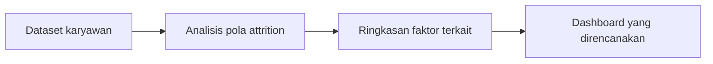
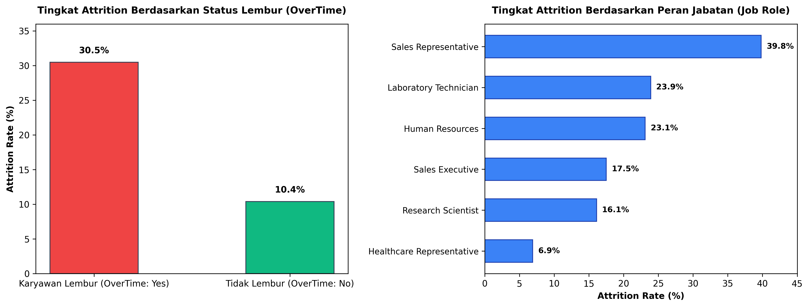

# Analisis Attrition Karyawan - Jaya Jaya Maju

Repository ini menjelaskan proyek analisis untuk memahami faktor yang berkaitan dengan karyawan yang meninggalkan perusahaan. Fokus bisnis dan sumber data di bawah berasal dari deskripsi proyek yang sebelumnya ada di README.

## Ringkasan yang dijelaskan dalam proyek

- Permasalahan: memahami pola attrition dalam data karyawan.
- Rencana analisis: mengeksplorasi data dan menyajikan temuan melalui dashboard.
- Sumber dataset yang disebutkan: [employee data dari Dicoding Academy](https://github.com/dicodingacademy/dicoding_dataset/blob/main/employee/employee_data.csv).

## Temuan Analisis & Visualisasi

*Gambar 1: Perbandingan tingkat attrition berdasarkan status jam lembur (OverTime) dan peran jabatan (Job Role).*

Berdasarkan eksplorasi dataset karyawan:
1. **Dampak Lembur (OverTime):** Karyawan dengan jam kerja lembur (*OverTime: Yes*) memiliki rasio keluar **$30.5\%$**, hampir $3\times$ lipat lebih tinggi dibandingkan karyawan non-lembur (**$10.4\%$**).
2. **Distribusi Peran Jabatan:** *Sales Representative* dan *Laboratory Technician* mencatatkan tingkat attrition tertinggi ($>23\%$), mengindikasikan beban kerja dan kompensasi awal sebagai faktor retensi kunci.

---

## Status repository

Pada branch utama yang diperiksa, repository hanya berisi README. Dataset, notebook/script analisis, dashboard, dan file dependency tidak tersedia di sini. Karena itu belum ada langkah instalasi atau perintah untuk menjalankan proyek yang dapat diverifikasi.

Angka dan kesimpulan yang pernah tercantum di dokumentasi lama belum dapat divalidasi terhadap kode atau artefak proyek pada repository ini. Sebaiknya tambahkan notebook/script, dashboard, serta visualisasi sumber sebelum mengutip angka tersebut.

## Catatan penggunaan data

Gunakan dataset sesuai ketentuan sumbernya dan jangan menambahkan data pribadi karyawan ke repository publik. Hasil analisis bersifat deskriptif; hubungan antarvariabel tidak otomatis membuktikan sebab-akibat.
